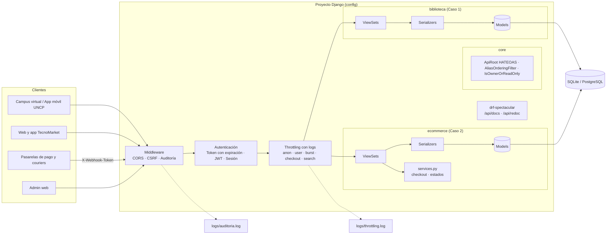
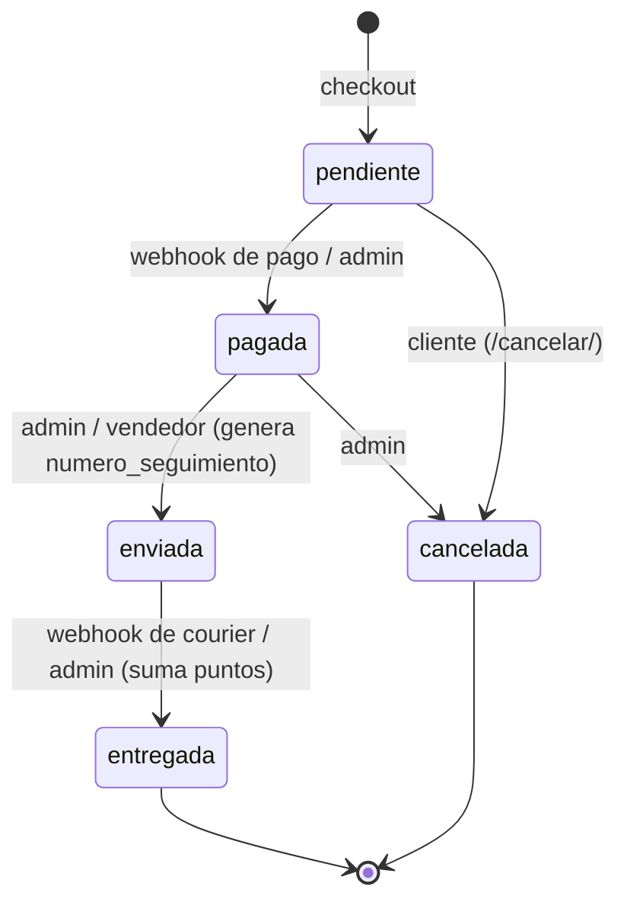

# semana13-daw-practica-02-grupal

API RESTful con **Django REST Framework** para la Práctica Grupal de la Semana 13 de
*Desarrollo de Aplicaciones Web (IS093A)* – Facultad de Ingeniería de Sistemas, UNCP.

Un solo proyecto Django resuelve **los dos casos** de la guía:

| Caso | App | Recursos principales |
|------|-----|----------------------|
| **1. Biblioteca Central UNCP** | `biblioteca` | `/api/libros/`, `/api/prestamos/`, `/api/usuarios/`, `/api/autores/`, `/api/reservas/`, `/api/adquisiciones/` |
| **2. TecnoMarket Perú (e-commerce)** | `ecommerce` | `/api/productos/`, `/api/carrito/`, `/api/ordenes/`, `/api/reseñas/`, `/api/categorias/`, `/api/vendedores/`, `/api/cuenta/`, `/api/webhooks/` |

## Integrantes y ramas

| Integrante | GitHub | Rama | Aporte principal |
|------------|--------|------|------------------|
| Chahuayo Martinez | [@devjuancarlos10](https://github.com/devjuancarlos10) | `chahuayo-martinez` | Configuración base, app `core`, Caso 1 (Biblioteca), script de datos, README, CI |
| Vivanco Solano | [@Jackeline-VS](https://github.com/Jackeline-VS) | `vivanco-solano` | Caso 2 (TecnoMarket), colección Postman, esquema OpenAPI |

Cada integrante trabajó en su rama y los cambios se integraron en `main` con merges `--no-ff`,
de modo que el historial muestra qué entró desde cada rama.

---

## Instalación paso a paso

Requisitos: Python 3.12 o superior (probado con 3.14) y Git.

```bash
# 1. Clonar
git clone https://github.com/devjuancarlos10/semana13-daw-practica-02-grupal.git
cd semana13-daw-practica-02-grupal

# 2. Entorno virtual
python -m venv venv
# Windows:
venv\Scripts\activate
# Linux/macOS:
source venv/bin/activate

# 3. Dependencias
pip install -r requirements.txt

# 4. Base de datos y datos de prueba
python manage.py migrate
python populate_data.py          # ambos casos (o: python populate_data.py biblioteca | tienda)

# 5. Levantar el servidor
python manage.py runserver
```

| URL | Descripción |
|-----|-------------|
| http://127.0.0.1:8000/api/ | Raíz navegable (HATEOAS) con enlaces a todos los recursos |
| http://127.0.0.1:8000/api/docs/ | Swagger UI |
| http://127.0.0.1:8000/api/redoc/ | ReDoc |
| http://127.0.0.1:8000/api/schema/ | Esquema OpenAPI 3.0 (YAML) |
| http://127.0.0.1:8000/admin/ | Admin de Django (sesión + CSRF) |

### Usuarios de prueba

| Caso | Usuario | Rol | Contraseña |
|------|---------|-----|------------|
| 1 | `admin` | Administrador (bibliotecario jefe, superusuario) | `Biblioteca2026!` |
| 1 | `bibliotecario1`, `bibliotecario2` | Bibliotecario | `Biblioteca2026!` |
| 1 | `docente1`, `docente2` | Docente / investigador | `Biblioteca2026!` |
| 1 | `estudiante1` … `estudiante7` | Estudiante | `Biblioteca2026!` |
| 2 | `admin_tienda` | Administrador (superusuario) | `TecnoMarket2026!` |
| 2 | `vendedor1` … `vendedor3` | Vendedor aprobado (`vendedor4` pendiente de aprobación) | `TecnoMarket2026!` |
| 2 | `cliente1` … `cliente20` | Cliente | `TecnoMarket2026!` |

### Datos generados por `populate_data.py`

| Caso 1 | Mínimo de la guía | Generado |
|--------|-------------------|----------|
| Libros | 50 | 55 (25 autores, 8 categorías, algunos sin stock) |
| Usuarios | 10 | 12 (todos los roles) |
| Préstamos | 30 | 36 (12 activos, 12 vencidos, 12 devueltos) + 6 reservas + 2 solicitudes |

| Caso 2 | Mínimo de la guía | Generado |
|--------|-------------------|----------|
| Productos | 100 | 215 (10 categorías, con imágenes y especificaciones JSON) |
| Usuarios | 20 | 25 (1 admin, 4 vendedores, 20 clientes) |
| Órdenes | 50 | 70 (en los 5 estados) |
| Reseñas | 100 | 151 (todas de compras verificadas) |

### Pruebas

```bash
python manage.py test                       # 52 tests
coverage run --source=core,biblioteca,ecommerce --omit="*/migrations/*,*/tests.py,*/populate.py" manage.py test
coverage report                             # ~94 %
```

El workflow [.github/workflows/ci.yml](.github/workflows/ci.yml) ejecuta en cada push/PR: `check`,
verificación de migraciones, validación estricta del esquema OpenAPI y los tests con cobertura mínima del 80 %.

### Colección Postman

Importar [docs/postman_collection.json](docs/postman_collection.json). Las peticiones *Login* de cada
carpeta **Auth** guardan los tokens en variables de colección, así que el orden recomendado es:
`Auth` → recursos. La carpeta *Seguridad* incluye la prueba de throttling (ejecutar con el Runner
25 iteraciones para obtener **429**) y la de CORS.

---

## Arquitectura



### Estructura del proyecto

```
├── config/                 # settings, urls raíz, wsgi/asgi
├── core/                   # piezas compartidas por ambos casos
│   ├── authentication.py   # ExpiringTokenAuthentication (tokens con expiración)
│   ├── throttling.py       # throttles que registran cada 429 en logs/throttling.log
│   ├── middleware.py       # auditoría de POST/PUT/PATCH/DELETE en logs/auditoria.log
│   ├── filters.py          # OrderingFilter con alias (?ordering=-año, ?ordering=título)
│   ├── permissions.py      # IsOwnerOrReadOnly
│   └── views.py            # raíz HATEOAS, login con token y logout
├── biblioteca/             # Caso 1
│   ├── models.py  serializers.py  views.py  filters.py  permissions.py  throttling.py
│   ├── populate.py         # datos de prueba del caso
│   └── tests.py            # 25 tests
├── ecommerce/              # Caso 2
│   ├── models.py  serializers.py  views.py  filters.py  permissions.py  throttling.py
│   ├── services.py         # checkout transaccional y máquina de estados de órdenes
│   ├── populate.py
│   └── tests.py            # 27 tests
├── docs/postman_collection.json
├── populate_data.py        # puebla ambos casos
└── requirements.txt
```

---

## Autenticación

| Método | Cómo obtenerlo | Header |
|--------|----------------|--------|
| Token DRF (expira a las 24 h, configurable con `TOKEN_EXPIRATION_HOURS`) | `POST /api/auth/token/` | `Authorization: Token <key>` |
| JWT (apps móviles, access 30 min / refresh 1 día) | `POST /api/auth/jwt/` y `/api/auth/jwt/refresh/` | `Authorization: Bearer <access>` |
| Sesión (admin web y API navegable) | `/admin/` o `/api-auth/login/` | cookie + CSRF |

```bash
curl -X POST http://127.0.0.1:8000/api/auth/token/ \
     -H "Content-Type: application/json" \
     -d '{"username": "estudiante1", "password": "Biblioteca2026!"}'
# {"token": "54ff7a31...", "usuario": "estudiante1", "expira_en_horas": 24}

curl -X POST http://127.0.0.1:8000/api/auth/logout/ -H "Authorization: Token 54ff7a31..."   # revoca el token
```

---

## Endpoints – Caso 1: Biblioteca

| Método | Endpoint | Permiso | Descripción |
|--------|----------|---------|-------------|
| GET | `/api/libros/` | Público | Catálogo paginado (20/pág) |
| GET | `/api/libros/{id}/` | Público | Detalle con autor anidado |
| POST | `/api/libros/` | Admin / bibliotecario | Crear |
| PUT/PATCH | `/api/libros/{id}/` | Admin / bibliotecario | Actualizar |
| DELETE | `/api/libros/{id}/` | Admin | Eliminar (bloqueado si tiene préstamos activos) |
| GET/POST/… | `/api/autores/` | Lectura pública | CRUD de autores |
| GET | `/api/prestamos/` | Autenticado | El personal ve todos; el resto, solo los suyos |
| POST | `/api/prestamos/` | Bibliotecario / admin + `PuedeCrearPrestamo` | Registrar préstamo (descuenta stock) |
| POST | `/api/prestamos/{id}/devolver/` | Bibliotecario / admin | `@action`: marca devuelto y repone stock |
| GET | `/api/prestamos/vencidos/` | Bibliotecario / admin | `@action` con `LimitOffsetPagination` |
| GET | `/api/usuarios/` | Admin | Listado (vista privada) |
| GET | `/api/usuarios/{id}/` | Público | Vista **privada** si es el propio usuario o un admin; **pública** en otro caso |
| PATCH | `/api/usuarios/{id}/` | Propietario o admin (`IsOwnerOrReadOnly`) | Actualiza email, teléfono, carrera |
| GET/PATCH | `/api/usuarios/perfil/` | Autenticado | `@action`: perfil del usuario autenticado |
| POST | `/api/reservas/` | Docente / investigador | Reservar libro |
| POST | `/api/adquisiciones/` | Docente / investigador | Solicitar adquisición (el admin aprueba con PATCH) |

**Filtros:** `?categoria=ingenieria`, `?año__gte=2020`, `?año__lte=2024`, `?disponible=true`,
`?search=algoritmos` (título, autor, ISBN, editorial), `?ordering=-año` u `?ordering=título`.

```bash
curl "http://127.0.0.1:8000/api/libros/?categoria=ingenieria&año__gte=2020&ordering=-año"
```

```json
{
  "count": 8, "next": null, "previous": null,
  "results": [{
    "id": 16, "url": "http://127.0.0.1:8000/api/libros/16/",
    "isbn": "978-612-4015-39-5", "titulo": "Algoritmos en Python",
    "autor": {"id": 1, "url": "http://127.0.0.1:8000/api/autores/1/", "nombre": "Thomas H. Cormen",
              "nacionalidad": "Estadounidense", "biografia": "..."},
    "editorial": "MIT Press", "año": 2024, "categoria": "ingenieria", "stock": 5,
    "disponible": true, "ubicacion": {"estante": "H-12", "piso": 4}
  }]
}
```

Registrar y devolver un préstamo:

```bash
curl -X POST http://127.0.0.1:8000/api/prestamos/ -H "Authorization: Token <bibliotecario>" \
     -H "Content-Type: application/json" -d '{"usuario": 6, "libro": 2}'
# {"id": 37, "estado": "activo", "dias_restantes": 14, "multa": "0.00", ...}

curl -X POST http://127.0.0.1:8000/api/prestamos/37/devolver/ -H "Authorization: Token <bibliotecario>"
```

## Endpoints – Caso 2: TecnoMarket

| Método | Endpoint | Permiso | Descripción |
|--------|----------|---------|-------------|
| GET | `/api/productos/` | Público | Catálogo (24/pág, `?page_size=` hasta 96) |
| GET | `/api/productos/{id}/` | Público | Detalle: especificaciones, imágenes, enlaces a reseñas |
| POST | `/api/productos/` | Admin o vendedor aprobado (`PuedeVender`) | Crear (con imágenes anidadas) |
| PUT/PATCH | `/api/productos/{id}/` | Vendedor dueño o admin | Actualizar |
| DELETE | `/api/productos/{id}/` | Admin | Eliminar |
| GET | `/api/productos/{id}/reseñas/` | Público | `@action`: reseñas del producto |
| GET | `/api/carrito/` | Autenticado (dueño) | Carrito actual con subtotal, IGV 18 %, total y descuento |
| POST | `/api/carrito/agregar/` · `eliminar/` · `actualizar/` · `vaciar/` | Dueño | `@action` |
| POST | `/api/carrito/aplicar-cupon/` | Dueño | `@action` (cupones de prueba: `CYBERWOW`, `BLACKFRIDAY`) |
| POST | `/api/carrito/checkout/` | Dueño, 10 req/h | `@action`: convierte el carrito en orden |
| POST | `/api/ordenes/` | Cliente, 10 req/h | Crear orden desde el carrito |
| GET | `/api/ordenes/` | Dueño / vendedor / admin | Paginación limit/offset (50) |
| PATCH | `/api/ordenes/{id}/` | Admin o vendedor de un producto de la orden | Cambiar estado |
| POST | `/api/ordenes/{id}/cancelar/` | Dueño o admin | `@action`, solo si está *pendiente*; repone stock |
| GET | `/api/ordenes/mis-ordenes/` | Autenticado | `@action` |
| GET | `/api/ordenes/resumen/` | Admin | Reporte: órdenes por estado, ingresos, top 5 productos |
| GET | `/api/reseñas/` | Público | Listado |
| POST | `/api/reseñas/` | Comprador verificado (`EsCompradorVerificado`) | Crear |
| PATCH/DELETE | `/api/reseñas/{id}/` | Dueño o admin | Editar / eliminar |
| GET/POST | `/api/categorias/`, `/api/vendedores/` | Lectura pública | Catálogo de categorías y tiendas; `POST /api/vendedores/{id}/aprobar/` (admin) |
| GET · PATCH · POST | `/api/cuenta/`, `/api/cuenta/actualizar/`, `/api/cuenta/registro/` | Autenticado / público | Perfil, puntos de fidelidad, registro |
| POST | `/api/webhooks/pagos/`, `/api/webhooks/logistica/` | Header `X-Webhook-Token` | Culqi/MercadoPago/Niubiz y Olva/Shalom |

**Filtros:** `?categoria=laptops`, `?marca=dell`, `?precio_min=500&precio_max=2000`, `?disponible=true`,
`?con_descuento=true`, `?rating_min=4`, `?search=gaming laptop`,
`?ordering=-precio | rating_promedio | -fecha_creacion`.

Flujo de estados de una orden:



```bash
# Agregar al carrito y pagar
curl -X POST http://127.0.0.1:8000/api/carrito/agregar/ -H "Authorization: Token <cliente>" \
     -H "Content-Type: application/json" -d '{"producto": 7, "cantidad": 1}'
curl -X POST http://127.0.0.1:8000/api/carrito/checkout/ -H "Authorization: Token <cliente>" \
     -H "Content-Type: application/json" \
     -d '{"direccion_envio": "Av. Huancavelica 1234, El Tambo, Huancayo", "metodo_pago": "culqi"}'
```

```json
{
  "id": 71, "url": "http://127.0.0.1:8000/api/ordenes/71/", "usuario": "cliente1",
  "items": [{"producto": "http://127.0.0.1:8000/api/productos/7/", "sku": "LAP-ASU-0007",
             "nombre_producto": "ASUS TUF Gaming F15", "precio_unitario": "3869.10", "cantidad": 1, "subtotal": "3869.10"}],
  "estado": "pendiente", "subtotal": "3869.10", "impuestos": "696.44", "descuento": "0.00", "total": "4565.54",
  "numero_seguimiento": "", "tiempo_estimado_entrega": {"desde": "2026-11-29", "hasta": "2026-12-01"}
}
```

---

## Throttling, CORS y seguridad

| Scope | Límite | Aplica a |
|-------|--------|----------|
| `biblioteca_anon` | 100/hora | Anónimos en el Caso 1 (catálogo público, sistemas externos) |
| `biblioteca_user` | 1000/hora | Usuarios autenticados del Caso 1 |
| `biblioteca_burst` | 20/minuto | Todos en el Caso 1 (anti-scraping) |
| `tienda_anon` | 60/hora | Anónimos en el Caso 2 |
| `tienda_user` | 2000/hora | Usuarios autenticados del Caso 2 |
| `tienda_checkout` | 10/hora | `/api/carrito/checkout/` y `POST /api/ordenes/` |
| `tienda_search` | 100/hora | Peticiones al catálogo con `?search=` (anti-scraping de precios) |
| `anon` | 30/minuto | `POST /api/auth/token/` (fuerza bruta de login) |

Cada rechazo (HTTP 429) se registra en `logs/throttling.log`:

```
[2026-11-26 10:41:03] WARNING api.throttling: THROTTLED scope=biblioteca_burst usuario=anonimo ip=127.0.0.1 metodo=GET ruta=/api/libros/
```

- **CORS:** `CORS_ALLOWED_ORIGINS` con `campus.uncp.edu.pe`, `app-movil.uncp.edu.pe`, `tecnomarket.pe`,
  `app.tecnomarket.pe` y `admin.tecnomarket.pe` (más `localhost` solo con `DEBUG`). `CORS_ALLOW_CREDENTIALS = True`
  y `CORS_URLS_REGEX = ^/api/.*$`.
- **CSRF:** el middleware sigue activo para el admin web y la autenticación por sesión. Las peticiones con
  `Token` o `Bearer` no usan cookies, así que DRF no exige CSRF en ellas; los webhooks no tienen autenticación de sesión.
- **HTTPS:** con `DJANGO_DEBUG=false` se activan `SECURE_SSL_REDIRECT`, HSTS y cookies seguras.
- **Auditoría:** cada `POST/PUT/PATCH/DELETE` sobre `/api/` queda en `logs/auditoria.log` (usuario, ruta, status, duración).
- **Variables de entorno:** `DJANGO_SECRET_KEY`, `DJANGO_DEBUG`, `DJANGO_ALLOWED_HOSTS`, `TOKEN_EXPIRATION_HOURS`, `WEBHOOK_SECRET`.

---

## Decisiones de diseño

1. **Un proyecto, dos apps.** Ambos casos comparten autenticación, throttling, auditoría y documentación
   (app `core`), pero cada dominio vive en su propia app. Así cada integrante trabajó en su app sin tocar
   archivos del otro y los merges no tuvieron conflictos.
2. **Throttles por caso.** Los límites de la guía difieren entre casos (100 vs 60 req/h para anónimos), por eso
   cada app declara sus clases con *scopes* propios en lugar de usar `DEFAULT_THROTTLE_CLASSES` global.
3. **Tokens con expiración.** `TokenAuthentication` de DRF no caduca; `ExpiringTokenAuthentication` invalida
   el token después de `TOKEN_EXPIRATION_HOURS` y `/api/auth/token/` emite uno nuevo.
4. **Roles mediante perfiles.** Se mantiene el `User` estándar de Django y se agregan `PerfilUsuario` (biblioteca),
   `Vendedor` y `PerfilCliente` (tienda) con `OneToOneField`. `is_staff` se interpreta como administrador en ambos casos.
5. **El bibliotecario puede consultar todos los préstamos.** La guía dice "propietario o admin", pero el
   bibliotecario debe encontrar el préstamo para devolverlo, así que el personal de biblioteca ve todos;
   estudiantes y docentes solo ven los suyos (los ajenos responden 404, sin revelar que existen).
6. **Serialización diferenciada de usuarios.** `GET /api/usuarios/{id}/` devuelve la vista pública (nombre,
   tipo, carrera) a cualquiera y la privada (email, teléfono, historial, `prestamos_activos`) solo al propio
   usuario o al admin. Así se combinan la "vista pública" y el `IsOwnerOrReadOnly` pedidos.
7. **Validación en dos capas.** El límite de 5 préstamos y la compra verificada se revisan en un permiso
   personalizado (`PuedeCrearPrestamo`, `EsCompradorVerificado`, responden 403) y de nuevo en el serializer.
8. **Estado "vencido" calculado al consultar.** `Prestamo.actualizar_vencidos()` se ejecuta antes de cada consulta
   de préstamos. Evita depender de un cron para la práctica; en producción sería una tarea programada.
9. **Snapshot de precios.** `ItemOrden` copia SKU, nombre y `precio_unitario` (con descuento) al hacer checkout;
   la orden no cambia si luego cambia el precio del producto.
10. **Checkout transaccional.** `services.checkout` usa `transaction.atomic` y `select_for_update` sobre los
    productos para evitar sobreventa con compras simultáneas (Cyber Wow / Black Friday).
11. **Un carrito activo por usuario** garantizado en la base de datos con `UniqueConstraint(condition=Q(activo=True))`.
12. **Máquina de estados explícita** (`Orden.TRANSICIONES`). Pasar a *enviada* genera `numero_seguimiento`,
    cancelar repone el stock y *entregada* suma puntos de fidelidad (1 punto por cada S/ 10).
13. **Alias con tildes.** La guía usa `?año__gte` y `?ordering=-año`/`título`; los campos del modelo son
    `anio`/`titulo` y los FilterSets y `AliasOrderingFilter` traducen los nombres con tilde.
14. **Listado ligero y detalle completo.** `ProductoListSerializer` omite descripción, especificaciones y enlaces a
    reseñas; el detalle los incluye. Los querysets usan `select_related`, `prefetch_related` y
    `annotate(Avg)` para evitar consultas N+1 (`rating_promedio` se calcula en SQL y es ordenable).
15. **Imágenes como URLs.** `ImagenProducto.url` es un `URLField` (CDN) en lugar de `ImageField`, lo que evita
    depender de Pillow y del almacenamiento de archivos.

## Mejoras futuras

- PostgreSQL + Redis (caché compartida para throttling entre varios workers).
- Tarea programada (Celery beat) para marcar préstamos vencidos y enviar recordatorios.
- Integración real con las APIs de Culqi/Niubiz (firmas HMAC por proveedor) y con los couriers.
- Versionado de la API (`/api/v1/`) y SDK generado desde el esquema OpenAPI.
